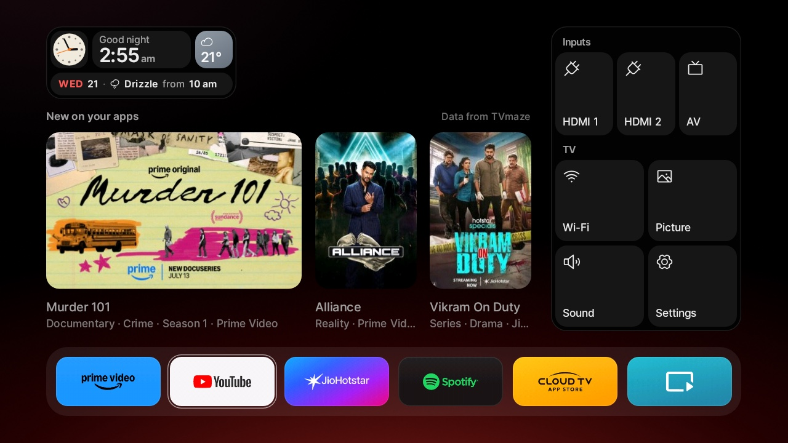

# Baron Home

A new home screen, a phone remote and a clean-up for a budget Indian "Cloud TV": a Baron 32-inch set
that runs CloudWalker's Cloud TV OS on a CVTE board with 512 MB of RAM. It started from Gathin's
[cleanyourtv](https://github.com/Gathin23/cleanyourtv) and grew into a home screen of its own, designed
first as a clickable web prototype and then built for the TV.

## What's in it

| Folder | What it is |
|---|---|
| [`home/`](home/) | **Baron Home** (`com.barontv.home`), the new home screen. Kotlin with plain Android views, no AndroidX or Compose, so it opens in under a second and uses about 58 MB on a 512 MB TV. |
| [`phone-app/`](phone-app/) | **Baron TV** (`com.barontv.remote`), an Android phone remote: a touch pad and keys, the TV's apps, what's playing with the volume, and the inputs. Kotlin and Jetpack Compose. |
| [`prototype/`](prototype/) | The clickable web prototype of the TV and phone screens, where every screen was designed and approved before it was built. |
| [`examples/baron-cloudtv-32/`](examples/baron-cloudtv-32/debloat.txt) | The clean-up list for this TV: CloudWalker's and CVTE's ads, trackers and updaters. |
| [`docs/baron-tv.md`](docs/baron-tv.md) | Notes on this TV and its firmware: getting ADB without developer options, and every quirk found on the way. |
| [`launcher/`](launcher/), [`tools/`](tools/), [`examples/`](examples/) | cleanyourtv as it was at the fork, with this TV's settings in its launcher, which stays installed as the fallback home. See [CLEANYOURTV.md](CLEANYOURTV.md). |

## The home screen

- **Clock:** a bento widget with a greeting, the time, the date and the weather from Open-Meteo, including
  what the weather does next, such as "Drizzle from 2 pm".
- **Shelf:** "New on your apps", new episodes on the installed streaming apps from TVmaze, or TMDB's
  trending titles once you add your own TMDB key.
- **App dock:** every app on a drawn cover in its brand colour, all at the same size and optical weight.
  Focus is a change of colour and a fine ring, and nothing grows or slides.
- **Side dock:** HDMI 1, HDMI 2 and AV, then Wi-Fi, Picture, Sound and Settings. Wi-Fi opens the nearby
  networks in place, and Sound turns the panel into one tall volume bar.
- **Glow:** one soft light below the dock, in the colour of the focused app.
- **Music mode:** when music plays and the remote rests, the screen dims and its edges glow in time with
  the beat, read by Android's Visualizer from the TV's own sound, while a small robot face dances. It can
  also pulse Philips WiZ Wi-Fi bulbs on the same network.
- **Now playing:** a pill at the top in the style of the iPhone's Dynamic Island, whenever the TV can tell
  what's playing.
- **Screensaver:** the old bouncing DVD logo after 10 minutes without a key press.

## The TV

| | |
|---|---|
| Set | Baron 32-inch HD LED "Cloud TV", sold in India |
| OS | CloudWalker Cloud TV OS on AOSP Android 9, with no Play Store and no Chromecast |
| Board | CVTE TP.SK518T.PB816, MediaTek `mt5862_512m`, Mali-G31 MP2 |
| Memory | 512 MB, 437 MB of it usable |
| Screen | 1366 x 768 panel, UI drawn at 1280 x 720 |

Everything here was built and tested on this one set. Other CloudWalker "Cloud TV" sets on CVTE boards
probably share most of it (the factory menu, the input broadcast, the firmware's habits), but compare
[docs/baron-tv.md](docs/baron-tv.md) with your TV before you install anything.

## Install

You need a Mac or Linux computer on the same Wi-Fi as the TV, JDK 17 and the Android SDK (platform 34 and
build-tools 34). cleanyourtv's ADB tools need Python 3, set up once with
`python3 -m venv tools/venv && tools/venv/bin/pip install -r tools/requirements.txt`.

1. **Get ADB.** Cloud TV has no developer options; ADB is a switch in CVTE's factory menu. See
   [Getting ADB](docs/baron-tv.md#getting-adb).
2. **Back up:** `TV_HOST=<tv ip> tools/backup.sh` saves the package lists and settings.
3. **Clean up:** `REMOVE=1 TV_HOST=<tv ip> tools/disable.sh examples/baron-cloudtv-32/debloat.txt`. This
   firmware switches disabled apps back on at every boot, so `REMOVE=1` removes them for your user
   instead. They stay in the system image, and `tools/restore.sh` brings them back.
4. **Settings (optional):** a `home/local.properties` with `weather.lat`, `weather.lon` and
   `weather.place` for your town (Bengaluru otherwise), and `tmdb.key` for TMDB's trending shelf.
5. **Install the home:** `TV_HOST=<tv ip> home/build-and-install.sh`. It builds and installs the app,
   makes it the Home, grants what it needs, and keeps the TV's previous settings so that
   `home/rollback.sh` can put them back.
6. **Phone app (optional):** `phone-app/share.sh` builds it and shows a QR code for installing it on an
   Android phone on the same Wi-Fi.
7. **Turn ADB off** in the factory menu when you're done, since it accepts any computer on your Wi-Fi.

To undo everything, run `home/rollback.sh` (add `UNINSTALL=1` to remove the app), then
`tools/restore.sh examples/baron-cloudtv-32/debloat.txt tv.cloudwalker.launcher.com`.

## Privacy and network

The home screen has no account, ads or analytics. It connects to:

- **Open-Meteo**, every 30 minutes, with the coordinates you set.
- **TVmaze** and its image servers, or **TMDB** if you add a key, for the shelf.
- **Devices on your own Wi-Fi:** a small bridge on port 5512 for the phone app ([its API](home/BRIDGE.md)),
  and WiZ bulbs over UDP port 38899 while music mode runs, only those already switched on.

The bridge has no pairing, like CloudWalker's own remote server on port 5511: anyone on your Wi-Fi can do
what the remote can do and see which app is playing. The phone app talks only to those two ports on the
TV.

Why the home asks for what it asks for:

- **Location:** Android 9 lists Wi-Fi networks and shows the network's name only with location on. The TV
  has no GPS, and nothing is ever located.
- **Microphone (`RECORD_AUDIO`):** Android's Visualizer needs it to read the TV's own sound for music mode.
  Nothing is recorded or sent anywhere.
- **Accessibility service:** the remote's Input and volume keys, music mode over the music app, and what's
  playing. It reads the music app's screen only when the phone asks what's playing.
- **`WRITE_SECURE_SETTINGS`**, granted by the install script: it switches that accessibility service back
  on, because the firmware drops it whenever an app is force-stopped.

## Limits on this TV

- **Netflix** won't run, because the set isn't Netflix certified. A streaming stick on HDMI is the way.
- The remote's **volume keys** still show CVTE's own pop-up: the firmware takes them before any app does.
- The firmware **force-stops the app you leave** whenever Home comes up, so music can't keep playing
  behind the home screen. Music mode runs over the music app instead.
- **No blur or video backgrounds:** the TV's older OpenGL renderer and its 512 MB rule them out.

## Measured on the TV

Cold start takes about 0.8 s and the home uses about 58 MB of memory. Moving focus round the screen gives
1.3% janky frames (p50 6 ms, p90 9 ms), and the screensaver runs at 60 fps.

## Credits

- [cleanyourtv](https://github.com/Gathin23/cleanyourtv) by [Gathin](https://github.com/Gathin23), for the
  method, the ADB tools and the launcher this started from.
- [Open Runde](https://github.com/lauridskern/open-runde) by Laurids Kern (SIL Open Font License 1.1) and
  [Phosphor Icons](https://phosphoricons.com) (MIT).
- Weather data by [Open-Meteo](https://open-meteo.com) (CC BY 4.0), shows by [TVmaze](https://www.tvmaze.com)
  (CC BY-SA 4.0), and [TMDB](https://www.themoviedb.org) when a key is set. This product uses the TMDB API
  but is not endorsed or certified by TMDB.

Third-party licences and trademarks are listed in [NOTICE.md](NOTICE.md).

## Licence

MIT, see [LICENSE](LICENSE). App names and logos belong to their owners and are used only to label their
apps.
